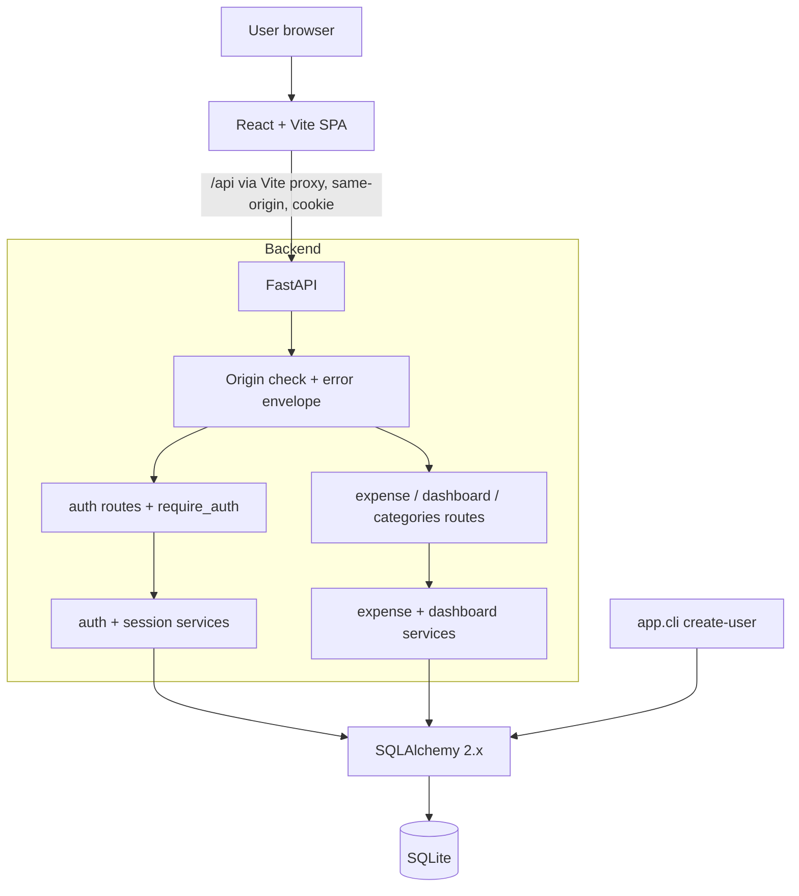

# Architecture

Status: finalised in Phase 5 against the implemented code (plan: `docs/plan/master-plan.md`). Diagram and module list match the files under `backend/app` and `frontend/src`.

## Modules

1. Authentication: single user, session cookie, Argon2id, provisioning CLI (ADR-002).
2. Backend API: FastAPI routes, services, error envelope, contract in `docs/api-contract.md`.
3. Database and persistence: SQLite, SQLAlchemy 2.x models, constraints, `create_all` (ADR-003..005).
4. Frontend: React + TypeScript (strict) + Vite, protected routes, dashboard, expense list and forms.
5. Testing and integration: pytest (unit in `backend/tests/unit`, black-box HTTP in `backend/tests/integration`), Vitest + RTL + MSW (`frontend/src/**/*.test.*`, `frontend/tests/flows.test.tsx`), Playwright E2E in `e2e/` (16-step workflow, persistence across backend restart, screenshots) on a temporary SQLite file with a run-time generated password.

## Code layout

- Backend: `app/main.py` (factory), `api/{auth,expenses,health}.py`, `core/{deps,errors,origin,security}.py`, `models/{user,session,expense}.py`, `schemas/{auth,expense}.py`, `services/{auth,expenses}.py`, `cli.py`, `config.py`, `db.py`.
- Frontend: `src/api` (typed client, 401 hook), `src/auth` (AuthContext), `src/components` (Layout, ProtectedRoute, ConfirmDialog, ToastProvider), `src/pages` (Login, Expenses, ExpenseForm, Dashboard), `src/lib/money.ts`.

## AI development system

Agents (`.github/agents/`): `orchestrator`, `backend`, `frontend`, `testing`, `documentation`. State lives in `docs/tasks.md` and `docs/agent-handoffs.md`; ownership in `.github/copilot-instructions.md`; skills in `.github/skills/`; prompts in `.github/prompts/`; hooks in `.github/hooks/`.

## Data model

- `users(id CHECK=1, username UNIQUE, password_hash, created_at)`
- `sessions(token_hash PK, user_id FK, created_at, expires_at)`
- `expenses(id, amount_cents CHECK>0, category CHECK in enum, description, expense_date indexed, created_at, updated_at)`

## Configuration

`.env` (gitignored) from `.env.example`: `DATABASE_URL`, `SESSION_TTL_MINUTES`, `COOKIE_SECURE`, `ALLOWED_ORIGINS`, `APP_TIMEZONE`, `INITIAL_USERNAME`, `INITIAL_PASSWORD`.

## Ports and commands

Backend 8000, frontend 5173. `make help` lists targets (`setup`, `seed-user`, `dev-backend`, `dev-frontend`, `lint`, `typecheck`, `test-backend`, `test-frontend`, `test-e2e`, `check`, `validate`, `validate-infra`).
