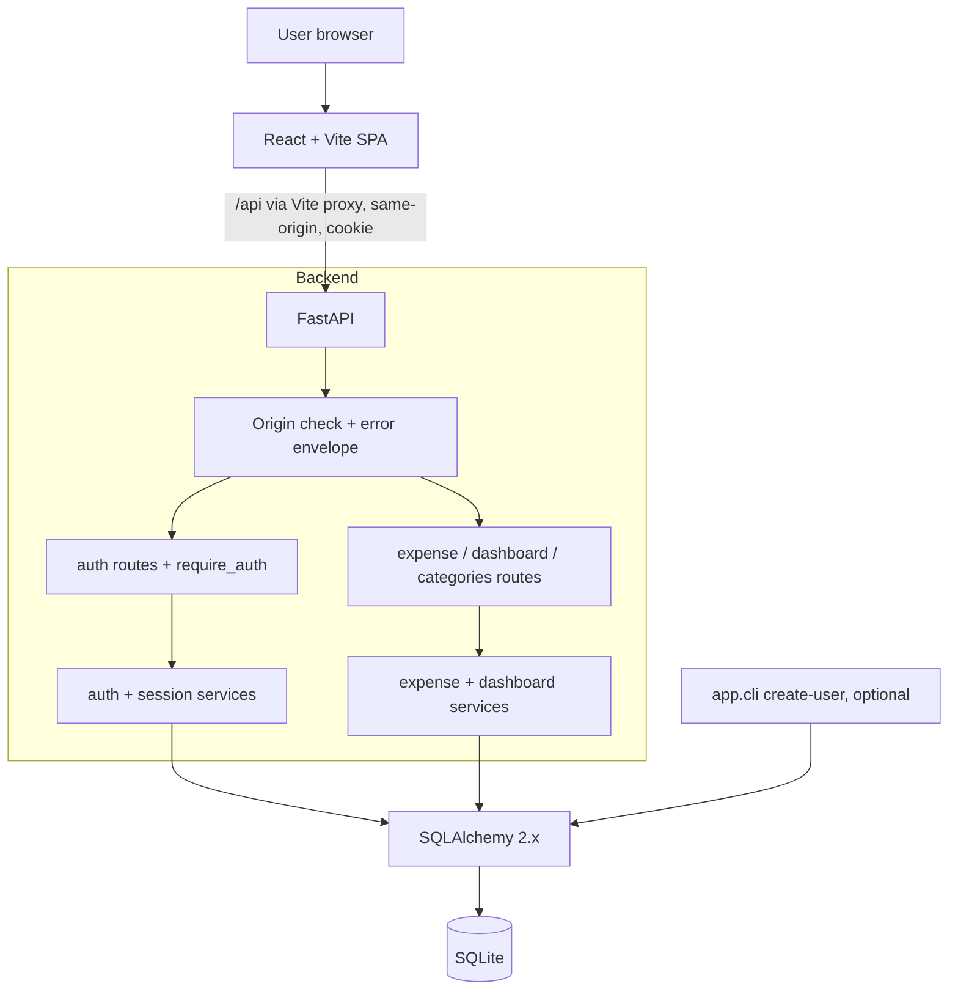

# Architecture

Status: finalised in Phase 5 against the implemented code (plan: `docs/plan/master-plan.md`). Diagram and module list match the files under `backend/app` and `frontend/src`.

## Modules

1. Authentication: multi-user with open sign-up, session cookie, Argon2id, per-user data isolation (ADR-002, ADR-011); optional user-creation CLI.
2. Backend API: FastAPI routes, services, error envelope, contract in `docs/api-contract.md`.
3. Database and persistence: SQLite, SQLAlchemy 2.x models, constraints, `create_all` (ADR-003..005).
4. Frontend: React + TypeScript (strict) + Vite, protected routes, dashboard, expense list and forms.
5. Testing and integration: pytest (unit in `backend/tests/unit`, black-box HTTP in `backend/tests/integration`), Vitest + RTL + MSW (`frontend/src/**/*.test.*`, `frontend/tests/flows.test.tsx`), Playwright E2E in `e2e/` (16-step workflow, persistence across backend restart, screenshots) on a temporary SQLite file with a run-time generated password.

## Code layout

- Backend: `app/main.py` (factory), `api/{auth,expenses,health}.py`, `core/{deps,errors,origin,security}.py`, `models/{user,session,expense}.py`, `schemas/{auth,expense}.py`, `services/{auth,expenses}.py`, `cli.py`, `config.py`, `db.py`.
- Frontend: `src/api` (typed client, 401 hook), `src/auth` (AuthContext), `src/components` (Layout, PageHeader, Tag, ProtectedRoute, ConfirmDialog, ToastProvider), `src/pages` (Login, Signup, Expenses, ExpenseForm, Dashboard), `src/lib` (`money.ts`, `categories.ts` icon map and month ranges, `text.ts` `truncateText`), `src/assets/cover.jpg`, one stylesheet `src/index.css`.

## Frontend UI (implemented in UI-01..UI-05)

Plain CSS, no UI, icon or animation library. Rules for the design are in `docs/design/ui-style-guide.md`; deviations are listed in its "Implemented" section.

- **Design tokens and dark theme:** CSS custom properties in `:root` in `index.css` (`--color-bg #191919`, surface, text, muted, border, primary, `--color-primary-strong #1a6fc9` for buttons, callout, danger, success). Dark only; there is no light theme. `prefers-reduced-motion` is respected.
- **Page shell:** `Layout.tsx` renders a sticky top bar (`position: sticky; top: 0; z-index: 10`, brand, Dashboard/Expenses links, username, Log out). Dialog backdrop (z-index 100) and toasts (110) stay above it. Content is centred, about 78 rem wide.
- **Page header:** `PageHeader.tsx` draws a decorative (`aria-hidden`) cover banner (`cover.jpg` under a dark gradient, hidden below 600 px), a rounded icon chip and the `h1`. The Expenses page adds a callout bar explaining the tabs.
- **Tags and icons:** `Tag.tsx` renders only the category text; the emoji comes from CSS (`.tag[data-icon]::before`), so text reads and E2E `innerText` stay clean. One fixed colour per category; rows also show a decorative category icon before the description.
- **View tabs:** "All / This month / Past month" buttons (`aria-pressed`) only set `date_from`/`date_to` in the existing filter state; no API change.
- **Tables:** Expenses table uses a fixed layout (Date, Category, Description, Amount, Actions with a wider gap before Actions); the description is one line, cut to 90 characters in code and with an ellipsis in CSS, full text in `title`. Footer "Total: N expenses" uses the list `total`. Dashboard recent-expenses table wraps full descriptions.
- **Pagination:** page size 10; the "Previous / Page X of Y / Next" nav renders only when there is more than one page.
- **Forms and auth pages:** centred cards; the expense form page is a centred 40 rem column; textareas resize vertically only.
- **360 px:** at <= 480 px the Expenses table uses smaller type and padding, a 4.5 rem description cap, wrapping tags and stacked Edit/Delete; `e2e/tests/mobile.spec.ts` checks there is no page-level horizontal scroll and writes `expenses-mobile.png`.

## AI development system

Agents (`.github/agents/`): `orchestrator`, `backend`, `frontend`, `testing`, `documentation`. State lives in `docs/tasks.md` and `docs/agent-handoffs.md`; ownership in `.github/copilot-instructions.md`; skills in `.github/skills/`; prompts in `.github/prompts/`; hooks in `.github/hooks/`.

## Data model

- `users(id, username (case-insensitive unique index), password_hash, created_at)`
- `sessions(token_hash PK, user_id FK, created_at, expires_at)`
- `expenses(id, user_id FK NOT NULL indexed, amount_cents CHECK>0, category CHECK in enum, description, expense_date indexed, created_at, updated_at)`

Every expense, list, dashboard and category query is filtered by the session user's id; another user's expense returns 404.

## Configuration

`.env` (gitignored) from `.env.example`: `DATABASE_URL`, `SESSION_TTL_MINUTES`, `COOKIE_SECURE`, `ALLOWED_ORIGINS`, `APP_TIMEZONE`; `INITIAL_USERNAME` and `INITIAL_PASSWORD` are used only by the optional CLI.

## Ports and commands

Backend 8000, frontend 5173. `make help` lists targets (`setup`, `dev-backend`, `dev-frontend`, `lint`, `typecheck`, `test-backend`, `test-frontend`, `test-e2e`, `check`, `validate`, `validate-infra`).
