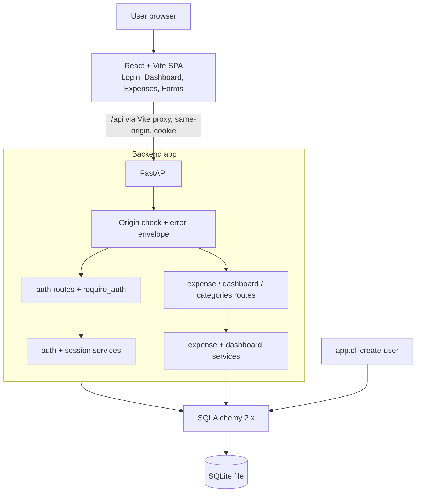

# Master Plan (approved) - AI-Driven Expense Tracker

Phase 1 output (GitHub Copilot Plan Mode, 2026-10-30), approved by the user. This file is a condensed copy of the approved plan (tables for per-prompt, per-task and per-test detail were shortened and are realised in `.github/` and `docs/tasks.md`); the full text lives in the Phase 1 chat transcript.
Decisions at approval: Local harness; all MAD tools in `.github/`; no MCP; external skills moved from `.agents/skills/` into `.github/skills/`; Python 3.12 via uv and Node 22.x via nvm (preflight outcome, see `docs/evidence/development-log.md`).

---

## Plan: Autonomous multi-agent AI development environment for the Expense Tracker

The plan covers Phase 1 only. A later Agent Mode session (Phase 2) creates the infrastructure under `.github/`, and specialised agents then build the app (Phases 3-5).

**Observed vs. assumed**
- **Observed** (VS Code and GitHub docs and skills.sh, fetched 2026-10-30):
  - Agents live in `.github/agents/*.agent.md`.
  - Skills live in `.github/skills/<name>/SKILL.md`.
  - Instructions live in `.github/copilot-instructions.md` and `.github/instructions/*.instructions.md` (with `applyTo`).
  - Prompt files (`.github/prompts/*.prompt.md`) and `handoffs` work only in the Local harness.
  - Subagents are controlled by `tools: ['agent']` plus `agents: [...]` and cannot nest by default.
  - Hooks live in `.github/hooks/*.json`. Local reads PascalCase events and `command` / `timeout` fields, and exit code 2 blocks.
  - `chat.useHooks` and a trusted workspace are required.
  - `npx skills add` for `github-copilot` installs into `.agents/skills/` and needs Node >= 22.20.
  - No verified `.github/` location exists for MCP config.
- **Not verified**:
  - Whether Local accepts `applyTo` with comma-separated globs.
  - Whether Local accepts the `read/edit/search/execute/agent/todo` tool aliases.
  - Whether agent-scoped hooks fire in Local.
  - The `tool_input` shape for edit tools.
  - Whether write-capable subagents can run in parallel.
- Each unverified item gets a smoke test in `validate-infra`, with a fallback.

---

## A. Executive Summary

Five custom agents work through a file-based task board:
- `orchestrator` delegates to `backend`, `frontend`, `testing` and `documentation` as subagents.
- Agents communicate only through repo files: `docs/tasks.md` (state), `docs/agent-handoffs.md` (reports), `docs/api-contract.md` (contract).
- Each agent has an exclusive set of directories, enforced three ways: path-ownership rules in the agent files, a hook, and a git-diff check script.
- A task reaches `VERIFIED` only when a different agent has re-run the check and recorded the evidence.
- Human checkpoints sit at plan approval, infra sign-off, the auth gate, the E2E pass, the report review, and publication (GitHub push and Google Drive upload).
- Evidence is collected from the start: a development log, curated prompts, a prompt-log hook, test outputs, and screenshots produced by Playwright.

---

## B. Assignment Compliance Matrix

| Assignment requirement | Where it is satisfied | Evidence |
|---|---|---|
| Small software project built with AI tools | Expense Tracker built by agents | Repo and git history |
| Idea and requirements, <= 1 page | Report 1 from `docs/architecture.md` | `docs/report/final-report.md` |
| AI-driven breakdown into modules | 5 modules: Authentication, Backend API, Database and persistence, Frontend, Testing and integration | `docs/architecture.md`, ADR-001 |
| Per module: approach, workflow, testing strategy, AI tool choice, 2-3 key prompts, <= 1/2 page | Evidence entries per module | `docs/evidence/development-log.md`, `docs/evidence/prompts.md`, `docs/test-report.md` |
| Challenges, tool comparison, improvements | Logged during work as `CHAL-nn` entries | `docs/evidence/development-log.md` |
| >= 2 screenshots of the working system | Playwright script writes PNGs | `docs/evidence/screenshots/` |
| GitHub repo link | Human pushes after final audit; the URL is never invented | Report, Repository section |
| Google Drive document, anyone-with-link, 3-6 pages | Markdown report, human exports and uploads | Human confirms |

Authenticity rules:
- Prompts are copied verbatim, with secrets redacted.
- Test results are pasted from saved run output.
- Challenges only come from real `CHAL` entries.
- The tool comparison covers only tools actually used. If only Copilot was used, it compares Copilot modes and models, not other products.

---

## C. Application Architecture

**Technology** (all pinned at install time by the agents):

| Item | Choice | Status |
|---|---|---|
| Backend | Python >= 3.12, FastAPI, Pydantic v2, SQLAlchemy 2.x, pydantic-settings, argon2-cffi, uvicorn | REQUIRED |
| Backend tests and lint | pytest, httpx `TestClient`, ruff | REQUIRED |
| Backend type checking | mypy on `app/` | OPTIONAL |
| Frontend | React, TypeScript (strict), Vite, react-router, plain CSS | REQUIRED |
| Frontend tests | Vitest, React Testing Library, jsdom, ESLint, MSW (network mocks for integration tests) | REQUIRED, MSW RECOMMENDED |
| Chart | Hand-written SVG, no chart library | RECOMMENDED |
| E2E | `@playwright/test` (Chromium only) in a separate `e2e/` package | REQUIRED |
| Dependency management | venv + pip with pinned `requirements*.txt`; npm with `package-lock.json` | REQUIRED |
| Entry points | Root `Makefile` that calls `scripts/*.sh` | RECOMMENDED |
| Migrations | None; `Base.metadata.create_all` on startup | Alembic excluded |
| CI | One guarded GitHub Actions workflow | RECOMMENDED |

**Backend modules** (`backend/app/`):
- `main.py` (app factory), `config.py` (settings), `db.py` (engine, session, `init_db`, SQLite `foreign_keys=ON`)
- `models/` (`user`, `session`, `expense`), `schemas/` (`auth`, `expense`, `dashboard`, `errors`)
- `services/` (`auth_service`, `session_service`, `expense_service`, `dashboard_service`)
- `api/` (`auth`, `expenses`, `dashboard`, `categories`, `health`)
- `core/` (`security.py` for hashing and tokens, `deps.py` for `require_auth` and the db session, `errors.py` for the envelope and handlers, `origin.py` for the origin middleware)
- `cli.py` (`create-user`)

**Frontend modules** (`frontend/src/`):
- `api/` (fetch client with `credentials: 'include'`, a central 401 handler, typed endpoint modules)
- `auth/` (`AuthContext`, `ProtectedRoute`)
- `pages/` (`Login`, `Dashboard`, `Expenses`, `ExpenseForm` for new and edit)
- `components/` (`AppLayout`, `ExpenseTable`, `ExpenseFilters`, `CategoryChart`, `ConfirmDialog`, `Toast`, `Spinner`, `EmptyState`)
- `lib/` (`money.ts` with string-based validation and `Intl` formatting, never float sums; `dates.ts`)
- Routes: `/login`, `/`, `/expenses`, `/expenses/new`, `/expenses/:id/edit`

**Database models**
- `users`: `id` (CHECK id = 1), `username` (unique), `password_hash`, `created_at`.
- `sessions`: `token_hash` (PK, SHA-256), `user_id` (FK), `created_at`, `expires_at`.
- `expenses`: `id`; `amount_cents` (INTEGER, CHECK > 0); `category` (CHECK in the 7 names); `description` (nullable, <= 500 characters, trimmed); `expense_date` (DATE, indexed); `created_at` and `updated_at` (UTC); index on `category`.

**Money and categories**
- **Money:** amounts are stored as integer cents. The API sends and accepts decimal strings (`"12.34"`). More than 2 decimals is a 422, with no silent rounding. The range is 0.01 to 999,999.99. There is a single implicit currency, shown with a configurable symbol. Sums use SQL `SUM` over integers.
- **Categories:** a `str` Enum plus a DB CHECK constraint (Food, Transport, Shopping, Bills, Entertainment, Healthcare, Other). The list is fixed, so there is no table or join, and no custom category management. `GET /api/categories` stops the frontend from hard-coding the list.

**Filtering semantics**
- `category` is a single value.
- `date_from` and `date_to` are both inclusive and are ISO dates. `date_from > date_to` returns 422.
- `sort=date_desc|date_asc` (default `date_desc`), ties broken by `id` in the same direction.
- `limit` defaults to 50 (max 200) and `offset` to 0. The response is `{items, total, limit, offset}`.
- The dashboard ignores list filters.
- "Current month" uses the configured `APP_TIMEZONE` (default UTC), with the clock injectable for tests.

**Error envelope** (all errors): `{"error": {"code", "message", "details"?}}`. Codes are `not_authenticated`, `invalid_credentials`, `validation_error`, `not_found`, `forbidden_origin`, `internal_error`. Stack traces are never returned.

**Configuration** (`.env`, gitignored; `.env.example` has placeholders only): `DATABASE_URL` (default `sqlite:///./data/expense_tracker.db`), `SESSION_TTL_MINUTES=480`, `COOKIE_SECURE`, `ALLOWED_ORIGINS`, `APP_TIMEZONE`, `INITIAL_USERNAME`, `INITIAL_PASSWORD` (used only by the CLI).

**API endpoints** (`/api` prefix; "auth" means a valid session cookie; Pydantic bodies): see `docs/api-contract.md` (contract v1, identical to the plan).

---

## D. Authentication Architecture Decision

| Criterion | A: Session cookie | B: JWT |
|---|---|---|
| Complexity | Low (one table, one dependency) | Low to medium (signing, key, claims) |
| Browser storage | HttpOnly cookie, invisible to JS | Needs a cookie (same CSRF concerns) or localStorage (XSS-exposed) |
| Logout | True server-side invalidation (row deleted) | Client-side deletion only; the token stays valid until expiry unless a denylist is added |
| Expiry and revocation | Server-controlled, instant | Expiry only; revocation needs state, which defeats the point |
| Local dev and testing | Vite proxy makes it same-origin; `TestClient` keeps cookies | Simple headers, but expiry tests need time forging |
| Fit for one user | Excellent | Overkill |

**Decision: server-side session cookie.** JWT is not implemented.
- **Token:** opaque, from `secrets.token_urlsafe(32)`. Only its SHA-256 is stored, so a DB leak does not expose live sessions.
- **Cookie `expense_session`:** HttpOnly, SameSite=Strict, Path=/, Max-Age equal to the TTL. `Secure` is driven by `COOKIE_SECURE`: off on `http://localhost` dev, true by default for any non-dev config, and tested.
- **Expiry:** absolute 480 minutes, no sliding window. Expired rows are purged at login. A reload keeps you logged in until expiry via `GET /api/auth/me`.
- **CSRF:** SameSite=Strict, plus a check on unsafe methods (POST, PUT, DELETE): if an `Origin` header is present it must be in `ALLOWED_ORIGINS`, otherwise 403. No CORS middleware at all (strictest), because the SPA and API are same-origin via the dev proxy. Double-submit tokens were rejected as unnecessary complexity.
- **Password hashing:** Argon2id via `argon2-cffi`. Unknown usernames are verified against a dummy hash, and errors are generic.
- **Logout:** deletes the session row. Reusing the old cookie returns 401, and a test asserts this.
- **Provisioning:** `python -m app.cli create-user` (`make seed-user`): reads `INITIAL_USERNAME` and `INITIAL_PASSWORD` from the environment, or prompts with `getpass`; fails in non-interactive mode if the password is missing. It is a no-op if the user exists. Overwriting needs the explicit `--reset-password` flag. There is no registration endpoint, and no plaintext password in the repo.
- **Protection by default:** the `expenses`, `dashboard` and `categories` routers declare `dependencies=[Depends(require_auth)]` at router level. A guard test enumerates every app route and asserts anonymous access returns 401, except an allow-list (`health`, `login`, `logout`, docs).
- **Frontend:** `AuthContext` calls `/me` at boot. `ProtectedRoute` redirects to `/login?next=...`. The fetch client turns any 401 (other than login) into "logged out" and a redirect. Route protection supplements backend enforcement; it never replaces it.

---

## E. Multi-Agent Architecture

**Verified orchestration facts** (Local harness):
- `tools: ['agent']` and `agents: [...]` let one agent call named custom agents as subagents.
- Each subagent runs in its own context and returns one message, so the delegation prompt must carry the task ID, files to read, and acceptance checks.
- Nested subagents are off by default, so only the orchestrator delegates.
- Handoff buttons give a human-gated alternative.
- An agent's body is added after the instructions and wins on conflict.

**Assumptions**
- Parallel write-capable subagents are plausible but unverified. Parallelism is allowed only for disjoint directories after the contract freeze; otherwise it runs sequentially.
- If delegation misbehaves, fall back to the human starting each specialist from its handoff button or the agent picker. The files-as-state protocol is unchanged.

**Agents** (`.github/agents/`). Tool aliases are an assumption to confirm in the editor's agent validation.

| Agent | Purpose and responsibilities | Tools | Allowed files (write) | Restricted |
|---|---|---|---|---|
| `orchestrator` | Reads the board, picks unblocked tasks, delegates, verifies independently (`make check`), manages gates, retries and escalation, and raises human checkpoints. Writes no app or test code. `agents: [backend, frontend, testing, documentation, Explore]`; `handoffs` buttons to `testing` and `documentation`. | read, search, edit, execute, agent, todo | `docs/tasks.md`, `docs/agent-handoffs.md`, `docs/decisions.md` | All source, tests, `.github/**` |
| `backend` | Python/FastAPI/SQLAlchemy/SQLite: models, init, provisioning, hashing, sessions, protected routes, CRUD, filters, dashboard, validation, errors, unit tests, and publishing and maintaining `docs/api-contract.md`. Owns authentication security. | read, search, edit, execute, todo | `backend/**` (tests: `backend/tests/unit/**`, `backend/tests/conftest.py`), `docs/api-contract.md`, backend lines of root `Makefile` / `.env.example` | `frontend/**`, `e2e/**`, `backend/tests/integration/**`, `.github/**` |
| `frontend` | React/TS/Vite: all pages, auth state, protected routes, API client, filters, forms, loading, error and empty states, a11y, colocated component tests, MSW setup. Follows `api-contract.md` and never invents auth behaviour. May start with MSW mocks once the contract is frozen. | read, search, edit, execute, todo | `frontend/**` (all `src/**/*.test.tsx`, `src/test/**`) | `backend/**`, `e2e/**`, `frontend/tests/**`, `.github/**` |
| `testing` | Independent QA and security reviewer: designs scenarios from requirements and `api-contract.md` (black-box), writes integration and E2E tests, runs everything, files defects, verifies fixes, produces test evidence. Has a review mode (auth security, architecture and complexity). Never silently edits production code. | read, search, edit, execute, todo | `backend/tests/integration/**`, `frontend/tests/**`, `e2e/**`, `docs/test-report.md`, `docs/defects.md`, `docs/evidence/test-runs/**`, `docs/evidence/screenshots/**` | All production code |
| `documentation` | Maintains architecture docs, compiles evidence, validates assignment coverage, drafts the report, finalises README. Never invents prompts, results or URLs. | read, search, edit, execute, todo | `docs/**` (except files owned above), `README.md` | Source code, tests |

**Shared by all agents**
- **Handoff mechanism:** the final message ends with a handoff block; the agent appends the same block to `docs/agent-handoffs.md` and updates its row in `docs/tasks.md`. The block holds: task ID, agent, completed work, modified files, decisions, test results (command plus exit code plus summary), known issues, dependencies, next action.
- **Validation:** an agent may mark a task `COMPLETED` only after running its own check and quoting the real output.
- **Definition of Done:** acceptance checks pass; the domain checks (`make check` targets) are green; the handoff is recorded; no files were edited outside the agent's ownership (`scripts/check-ownership.sh` passes).

**Task states:** `TODO -> IN_PROGRESS -> BLOCKED | COMPLETED -> VERIFIED`. `COMPLETED` is claimed by the owner with evidence. `VERIFIED` may only be set by an agent that did not implement the task, after re-running the check and linking the output.

**Conflict avoidance:** exclusive directories, sequential handoffs, one writer per file, single-branch work, no parallel work on shared files.

---

## F. Copilot Instructions

| File | Scope (`applyTo`) |
|---|---|
| `.github/copilot-instructions.md` | Always on (goals, stack, phases, security principles, scope exclusions, evidence rule, DoD, ignore user-level `kate-*` / `kbc-*` skills) |
| `.github/instructions/backend.instructions.md` | `backend/**` |
| `.github/instructions/frontend.instructions.md` | `frontend/**` |
| `.github/instructions/testing.instructions.md` | `backend/tests/**`, `frontend/**/*.test.{ts,tsx}`, `frontend/tests/**`, `e2e/**` |
| `.github/instructions/documentation.instructions.md` | `docs/**`, `README.md` |

All are additive; each rule lives in exactly one file.

---

## G. Agent Skills

External (verified on skills.sh 2026-10-30; audits Trust Hub / Socket / Snyk):
- `fastapi` (`fastapi/fastapi`) PASS/PASS/PASS - RECOMMENDED - backend
- `vercel-react-best-practices` (`vercel-labs/agent-skills`) PASS/PASS/PASS - OPTIONAL - frontend
- `playwright-best-practices` (`currents-dev/playwright-best-practices-skill`) PASS/PASS/PASS - RECOMMENDED - testing
- `verification-before-completion` (`obra/superpowers`) PASS/PASS/PASS - RECOMMENDED - all

Install: `npx skills add <github url> --skill <name> -a github-copilot --copy -y` with `DISABLE_TELEMETRY=1`; review; move from `.agents/skills/` to `.github/skills/`; delete `.agents/`.
Rejected: `webapp-testing`, `playwright-cli` (Socket/Snyk WARN); `test-driven-development` (OPTIONAL, not installed).

Custom: `fastapi-feature-development`, `single-user-auth`, `react-feature-development`, `automated-testing`, `ai-dev-evidence`, `agent-handoff`.

---

## H. Reusable Prompts (`.github/prompts/`, Local harness)

`setup-environment`, `continue-development`, `implement-auth`, `implement-backend`, `implement-frontend`, `integrate-application`, `generate-tests`, `review-auth-security`, `validate-application`, `fix-defects`, `generate-exam-documentation`, `final-audit`. (`review-implementation` merged into `validate-application`.)

---

## I. MCP and Hooks

MCP: none (no verified `.github/` location; native tools and the Playwright runner suffice).

Hooks (`.github/hooks/*.json`, Node `.mjs` scripts, Local PascalCase format, exit code 2 blocks): `safety` (PreToolUse), `quality` (PostToolUse ruff format; Stop quality gate honouring `stop_hook_active`), `context` (SessionStart), `evidence` (UserPromptSubmit logger, redacted, gitignored), per-agent ownership guard (OPTIONAL, UNVERIFIED in Local; fallback `scripts/check-ownership.sh`). No git hooks. CI in `.github/workflows/ci.yml`.

---

## K. Autonomous Execution Workflow

Phases: 1 Plan -> HC1 -> 2 Infra -> HC2 -> Stage B backend foundation (parallel: Stage E frontend scaffold with MSW after contract freeze) -> Stage C auth -> HC3 -> Stage D expenses -> Stage F integration -> Stage G tests/E2E <-> Stage H defect loop -> HC4 -> Phase 5 documentation -> HC5 -> HC6 human publishes.

Retry limit: 3 fix attempts per defect, then BLOCKED and human escalation; max 5 delegation cycles per stage; Stop hook forces at most one extra turn.

Human checkpoints: HC1 plan, HC2 infra (and one local commit), HC3 auth review, HC4 E2E pass, HC5 report/secrets/screenshots, HC6 push and Drive upload (anyone-with-link).

---

## L. Testing Strategy

- Backend unit (backend agent), backend integration black-box (testing agent), frontend component (frontend agent; Vitest, RTL, MSW), frontend integration (testing agent), E2E Playwright (testing agent; 16-step workflow plus persistence scenario with backend restart; runtime-generated test credentials; temp DB), security review (testing agent review mode).
- Commands via Makefile: `setup`, `seed-user`, `dev-backend`, `dev-frontend`, `lint`, `typecheck`, `test-backend`, `test-frontend`, `test-e2e`, `check`, `validate`, `validate-infra`. Ports: backend 8000, frontend 5173.

---

## M. Documentation Strategy

Evidence starts in Phase 2. Every agent applies `ai-dev-evidence` after significant work. Sources: prompt-log hook, manual prompt records, `docs/evidence/test-runs/*.txt`, Playwright screenshots, git history, redacted Copilot debug-log excerpts. Final report `docs/report/final-report.md` within 3-6 pages; compliance matrix in `docs/assignment-evidence.md`. Nothing is claimed published or shared until a human confirms.

---

## N. Implementation Roadmap

The full task list (INF-01..11, B/A/X/F/I, T/D, DOC) is seeded in `docs/tasks.md`.

---

## O. Risks and Mitigations

Orchestration/parallelism limits (sequential default, handoff buttons, `/continue-development`); missing tools (checked in INF-01); unsafe external skills (audit, 4-skill cap); personal `kate-*`/`kbc-*` skills auto-triggering (explicit ignore rule); subagent context loss (delegation template, files as state); conflicting edits (ownership hook + `check-ownership.sh`); auth defects (router-level protection, guard test, independent tests, HC3); API mismatch (frozen contract, MSW, I-01); test-failure loops (3-attempt cap); missing evidence (evidence in DoD, HC5); over-engineering (small stack); secrets leakage (`.env` ignored and denied by hook, redaction, secrets scan); settings outside `.github/` (manual checklist printed by `validate-infra`).

---

## P / Q. Setup instructions and first execution prompt

Executed in the Phase 2 session; see `docs/evidence/development-log.md` for what actually happened.
